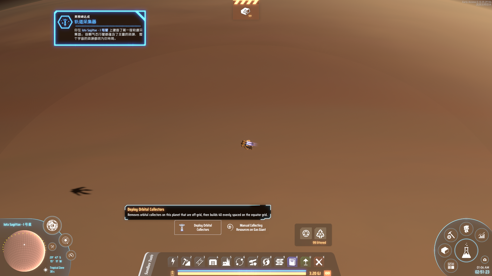
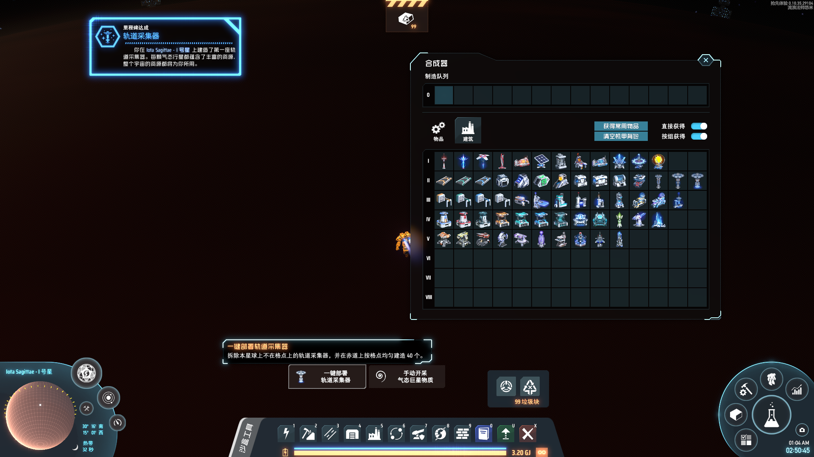

# CollectorDeployer

Read me in English

***Deploy 40 orbital collectors on a gas giant with one click***

## Overview

* On a gas giant, a **Deploy Orbital Collectors** button appears to the left of the vanilla "Manual Collecting Resources on Gas Giant" button.
* One click builds **40 orbital collectors** evenly spaced on the equator, all snapped to the building grid.
  * The equator of a gas giant has 400 grid points; a collector is placed on every 10th one.
  * 40 is the maximum the vanilla spacing rule allows on the equator.
  * Collectors are finished instantly; you don't need to fly around the planet.
* Collectors already on the right grid points are kept as they are. Off-grid collectors (and unfinished ones) are removed and rebuilt; they and the items stored in them go back to your inventory.
* Clicking again once all 40 are in place does nothing.
* Building and removal use the game's own functions, the same ones used for normal construction and dismantling.

## When nothing is deployed

* **Not enough orbital collectors**: you need 40 minus the ones kept, counting both your inventory and the collectors that will be removed. If you don't have enough, a tip is shown and nothing changes.
* **More than 40 collectors on the planet** (for example, another mod lifted the limit): nothing is deployed.
* **The planet can't power collectors**: same check as placing one by hand.

## Inventory space

* Normally the deployment happens right away, without any confirmation.
* Only if your inventory can't hold everything the removal returns, a dialog lists the items that would be dropped and asks whether to continue.

## Whole galaxy (optional, off by default)

* Turn on `EnableGalaxyDeploy` to get a second button, **Deploy in Whole Galaxy**, between the two buttons above.
* It does the same thing on **every gas giant in the galaxy**, including ones you have never visited, without flying there.
* A summary is always shown first: how many gas giants, how many collectors will be built and removed, which planets are skipped, and any items that would drop.
* If you don't have enough collectors for all of them, nothing is deployed.

## Config

* `BepInEx/config/com.yummi.dsp.collectordeployer.cfg`, or the r2modman Config editor
  * `EnableGalaxyDeploy`: `false` (default) or `true`. Shows the whole-galaxy button.

## Language

* The button and messages are in Chinese when the game language is Chinese, and in English otherwise.

## Notes

* Multiplayer is untested.

## CREDITS

* [Dyson Sphere Program](https://store.steampowered.com/app/1366540): The great game
* [BepInEx](https://bepinex.dev/): Base modding framework

## Author

* cat yummi

中文说明

***气态巨星上一键部署 40 个轨道采集器***

关键字：一键部署、一键建造

## 功能说明

* 在气态巨星上，原版"手动开采气态巨星物质"按钮左侧会出现**一键部署轨道采集器**按钮。
* 点一下即在赤道上按格点均匀建造 **40 个轨道采集器**。
  * 气态巨星赤道一圈共 400 个格点，每 10 格放一个。
  * 40 个是原版间距规则下赤道能放下的上限。
  * 立即完工，不需要绕着星球飞一圈。
* 已经在正确格点上的采集器原样保留；不在格点上的（以及未完工的）会被拆除重建，采集器和其中储存的物品返还背包。
* 40 个都已就位时再点不会有任何改动。
* 建造和拆除都调用游戏自身的函数，与正常建造、拆除的流程一致。

## 不会部署的情况

* **轨道采集器不足**：需要的数量为 40 减去保留的数量，背包里的和拆除返还的都算在内。不够时会提示，不做任何改动。
* **星球上已有超过 40 个轨道采集器**（例如其他 mod 放宽了限制）：不部署。
* **该星球无法驱动轨道采集器**：与手动放置时的判定相同（含创世之书等将气态巨星采集改为不依赖可燃气体发热的玩法）。

## 背包空间

* 正常情况下直接部署，不弹任何确认。
* 只有当背包放不下拆除返还的物品时，才会弹窗列出会掉落的物品，并询问是否继续。

## 全银河部署（可选，默认关闭）

* 打开 `EnableGalaxyDeploy` 后，两个按钮之间会多出一个**一键部署全银河**按钮。
* 对**全银河所有气态巨星**做同样的部署，包括没去过的，不需要飞过去。
* 执行前一定会弹窗显示汇总：多少颗气巨、新建和拆除多少个、哪些星球被跳过，以及会掉落的物品。
* 采集器不够全部部署时，一颗都不部署。

## 配置

* `BepInEx/config/com.yummi.dsp.collectordeployer.cfg`，或 r2modman 的 Config editor
  * `EnableGalaxyDeploy`：`false`（默认）或 `true`，是否显示全银河部署按钮。

## 语言

* 游戏语言为中文时按钮和提示显示中文，其他语言显示英文。

## 注意事项

* 未在多人游戏中测试。

## 鸣谢

* [戴森球计划](https://store.steampowered.com/app/1366540): 伟大的游戏
* [BepInEx](https://bepinex.dev/): 基础模组框架

## 制作人

* 流浪法师.悠米

